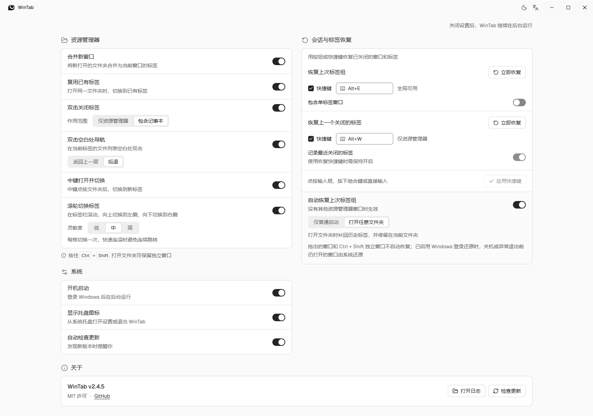

# WinTab

File Explorer tab utility for Windows 11

[简体中文](README.md) | English

  

WinTab folds your File Explorer windows into one: newly opened windows become tabs automatically, the same folder reuses its existing tab, and your tab groups and recently closed tabs can be brought back at any time.

---

## Features

- One window, multiple tabs: newly opened File Explorer windows are merged into the active window as tabs
- Reuse the existing tab instead of opening the same folder twice
- Tab groups are saved continuously and can be recovered after shutdown or an Explorer crash; recently closed tabs can be reopened too
- Scroll the wheel over the tab row to switch to the previous or next tab, with Low / Medium / High sensitivity
- Double-click a tab title to close it
- Middle-click a folder in the navigation pane, file list, Home or the address bar to open it in the foreground
- When native focus such as "Open file location" lands on a background tab, that tab is brought to the front
- Hold `Ctrl + Shift` while opening folders to keep a separate window; drag a tab off the tab row to split it into a new window
- Runs from the system tray, starts with Windows, and switches between light / dark themes and Chinese / English

## Tab recovery

WinTab records tab groups while running, so they survive a shutdown or an Explorer crash; by default only windows with two or more tabs are recorded. The tray menu and the settings page provide:

- **Restore last tab group**: restore the group in a new window, keeping tab order and the saved active tab. Default shortcut `Alt + E`, works globally
- **Reopen last closed tab**: reopen the most recently closed tab. Enabled by default; default shortcut `Alt + W`, works only while Explorer is in the foreground. When a location can no longer be opened, it is skipped and the newest openable tab is restored instead

Each shortcut can be enabled or re-bound independently, without automatic restoration; turning automatic restoration off does not affect background recording or manual recovery.

**Auto-restore last tab group** is off by default. When enabled, it is triggered only by a newly opened window when no other File Explorer windows are open: by default it restores only on launch to Home, This PC or the configured start folder, or on opening any folder it can keep the current tabs and append the saved ones. Torn-off windows and `Ctrl + Shift` windows do not trigger it. With Windows' **Restore previous folder windows at logon** turned on, Windows restores the windows itself and WinTab does not add the same group again; manual recovery still works.

## Double-click empty space

Off by default. When enabled, double-clicking the empty space of the file list navigates within the current tab: choose "Up one level" (default) or "Back".

## Download

Pick the installer that matches your CPU architecture ([Releases](https://github.com/OUBIGFA/WinTab/releases)):

- `WinTab_<version>_x64_Setup.exe` — 64-bit Intel/AMD (most users)
- `WinTab_<version>_arm64_Setup.exe` — ARM64 Windows (Surface Pro X, Snapdragon laptops)
- `WinTab_<version>_x86_Setup.exe` — 32-bit Windows

In-app updates check the installer's SHA-256 hash and do not run an installer that does not match.

## Requirements

- Windows 11 22H2 or newer
- .NET 9 Desktop Runtime (the installer downloads it on first run if missing)

## License & Acknowledgements

Released under the MIT License.

Portions of the source code are derived from [ExplorerTabUtility](https://github.com/w4po/ExplorerTabUtility) (Copyright (c) w4po, MIT License). See [THIRD-PARTY-NOTICES.md](THIRD-PARTY-NOTICES.md) for attribution and the full license text.
