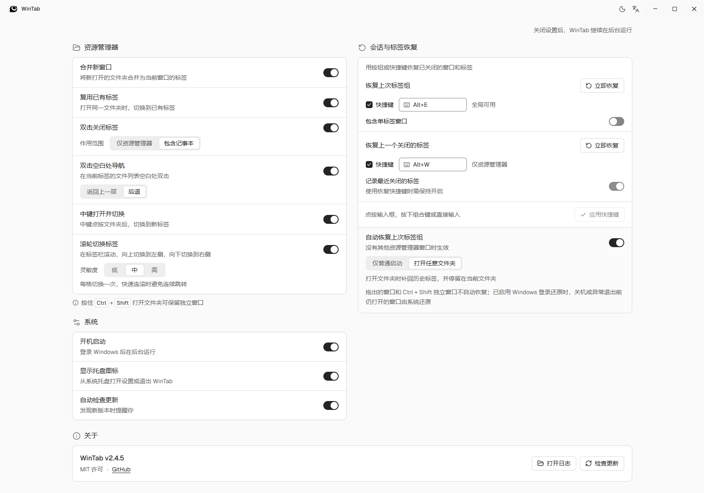

# WinTab

Windows 11 文件资源管理器标签页工具

简体中文 | [English](README.en.md)

  

WinTab 把资源管理器的多个窗口收进一个窗口：新打开的窗口自动合并为标签页，相同文件夹复用已有标签，标签组与最近关闭的标签页可随时找回。

---

## 功能

- 一窗多标签：新打开的资源管理器窗口自动合并为当前窗口的标签页
- 复用已有标签页，不重复打开同一文件夹
- 持续保存标签组，关机或资源管理器崩溃后可恢复；最近关闭的标签页也能找回
- 鼠标停在标签栏上滚动滚轮切换前后标签，灵敏度可选低／中／高
- 双击标签页标题直接关闭
- 中键点击侧边栏、文件列表、主页或地址栏中的文件夹时，一律在前台打开
- 「打开文件所在位置」等原生定位落到后台标签时，自动把该标签切到前台
- 按住 `Ctrl + Shift` 打开文件夹可保留独立窗口；把标签拖出标签栏可分出新窗口
- 托盘常驻运行，支持开机启动，可切换深／浅色主题与中英文界面

## 标签恢复

WinTab 运行时持续记录标签组，关机或资源管理器崩溃后仍可找回，默认仅记录含两个及以上标签的窗口。托盘菜单和设置页提供：

- **恢复上次标签组**：在新窗口中按原顺序恢复标签组和原活动标签。默认快捷键 `Alt + E`，全局生效
- **恢复上一个标签页**：重新打开最近关闭的标签。默认开启，默认快捷键 `Alt + W`，仅资源管理器在前台时生效；位置已无法打开时自动跳过，恢复更早一个可打开的标签

两个快捷键都可单独启用或改键，无需开启自动恢复；关闭自动恢复也不影响后台记录和手动恢复。

「自动恢复上次标签组」默认关闭。开启后仅在没有其他资源管理器窗口时，由新打开的窗口触发：默认只在从主页、此电脑或设定的启动位置启动时恢复，也可改为打开任意文件夹时保留现有标签并在其后补回历史标签。拖出或 `Ctrl + Shift` 保留的独立窗口不触发恢复。若已在文件夹选项中开启系统的「登录时还原上一个文件夹窗口」，Windows 会自行还原，WinTab 不再重复补回同一标签组，仍可手动恢复。

## 双击空白处导航

默认关闭。开启后，在文件列表的空白处双击即可在当前标签内导航：可选「返回上一层」（默认）或「后退」。

## 下载

根据 CPU 架构选择对应安装器（[Releases](https://github.com/OUBIGFA/WinTab/releases)）：

- `WinTab_<版本>_x64_Setup.exe` — 64 位 Intel/AMD（大多数用户）
- `WinTab_<版本>_arm64_Setup.exe` — ARM64 Windows（Surface Pro X 等）
- `WinTab_<版本>_x86_Setup.exe` — 32 位 Windows

应用内更新会校验安装包的 SHA-256，校验不一致时不运行安装器。

## 系统要求

- Windows 11 22H2 或更高版本
- .NET 9 Desktop Runtime（首次运行安装器会自动下载安装）

## 许可与致谢

本项目以 MIT License 发布。

部分源代码派生自 [ExplorerTabUtility](https://github.com/w4po/ExplorerTabUtility)（Copyright (c) w4po，MIT License）。相关归属与许可全文见 [THIRD-PARTY-NOTICES.md](THIRD-PARTY-NOTICES.md)。
